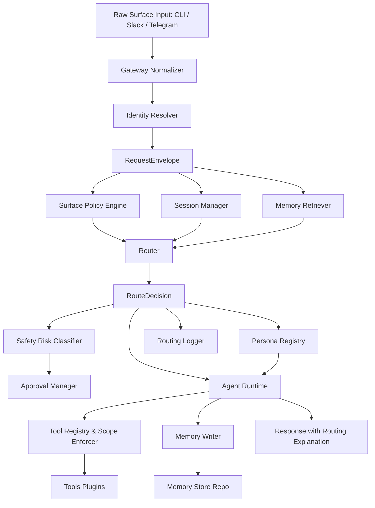

# Architecture Overview: Surface-Aware Agent Orchestration

## 1. Core Problem
Traditional multi-agent systems treat input prompts identically regardless of whether they arrive from an IDE terminal, a Slack thread, a Telegram bot, or a web dashboard. 

**Surface-Aware Agent Orchestration** incorporates the origin surface, its operational affordances, urgency cues, multi-turn session state, and shared cross-surface episodic memory into every routing and execution decision.

## 2. Request Lifecycle Step-by-Step

1. **Surface Ingestion**: An incoming message or webhook event is received by a surface adapter (`A1` Telegram/Slack, `A2` CLI).
2. **Event Normalization (`A3`) & Identity (`A4`)**: The Gateway packages the raw input into a canonical `RequestEnvelope`, resolving external IDs (e.g. Telegram chat IDs) to internal `user_id` values.
3. **Surface Policy Evaluation (`B1`)**: Evaluates `surfaces.yaml` to detect urgency keywords, token budgets, and default autonomy constraints.
4. **Context Gathering (`B3`, `E3`)**: Pulls active conversation history from `SessionManager` and relevant cross-surface memories from `MemoryRetriever`.
5. **Route Decision Synthesis (`B2`)**: The Router produces a `RouteDecision` containing:
   - `persona`: The assigned agent specialist (`coder`, `researcher`, `ops`, `writer`).
   - `tool_scope`: Whitelist of permitted tools.
   - `autonomy`: Level of operational autonomy (`supervised`, `semi`, `full`).
   - `confidence`: Confidence score (0.0 to 1.0).
   - `reasoning`: Natural-language justification.
6. **Execution (`C1`, `C2`, `C3`, `C4`)**: The Persona definition is retrieved, tool permissions are enforced by `ToolScopeEnforcer`, actions are risk-checked by `D1`/`D2`, and the `AgentRuntime` generates the response.
7. **Cross-Surface Memory Persistence (`E2`, `E1`)**: Interaction facts and summaries are stored in the memory repository.
8. **Transparency & Formatting (`F1`)**: The `RoutingLogger` prepends the mandatory transparency explanation line (`Summoned <persona> because ...`) and packages the final `Response`.

## 3. Pluggable Extension Model
Every component is registered via in-memory factories and registries (`RouterRegistry`, `RuntimeRegistry`, `LLMProviderRegistry`, `ToolRegistry`, `MemoryStoreRegistry`), allowing teammates to swap implementations purely through configuration (`config/*.yaml`) without changing orchestrator logic.
